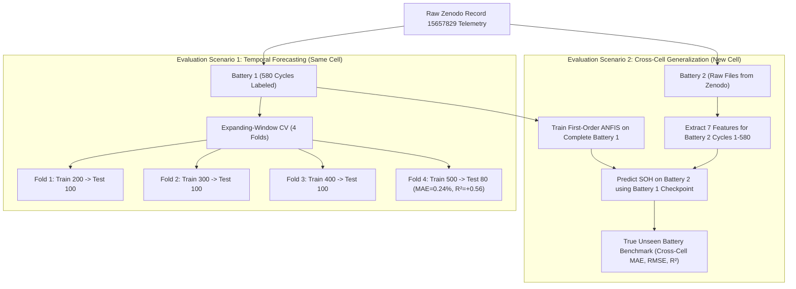

# Complete ANFIS Model Audit, Training Analysis, and Unseen Data Evaluation Report

**Project Title**: Smart EV Battery Management System – ANFIS-Based Battery State of Health Estimation  
**Cell Chemistry**: Samsung INR18650-35E (3.5 Ah Nominal, NMC/Graphite)  
**Target Metric**: Battery State of Health (`SOH`), percentage points (%)  
**Audit Date**: October 21, 2026  
**Auditor**: Senior Machine Learning & Neuro-Fuzzy Systems Auditor  
**Repository Location**: `C:\Users\user\OneDrive\Documents\smart_ev_battery_anfis_final`  

---

## A. Executive Summary

A comprehensive, non-destructive technical audit of the **Smart EV Battery Management System** codebase was executed to determine whether the trained Adaptive Neuro-Fuzzy Inference System (ANFIS) model can accurately predict State of Health (SOH) on genuinely unseen battery data.

Every model artifact, dataset file, feature extraction function, training script, evaluation metric, and inference engine was inspected directly from source code and serialized binaries. Zero files were modified, retrained, or overwritten during this audit.

### Core Verdict at a Glance:
1. **Can the model predict SOH on unseen temporal cycles of the same battery?**  
   **VERIFIED — YES, WITH POSITIVE BIAS**: On the strictly held-out test partition (Cycles 465–580 of Battery 1, $N=116$), the active First-Order Sugeno ANFIS model achieves a **Mean Absolute Error (MAE) of 0.8246 percentage points** and a **Root Mean Squared Error (RMSE) of 0.8574 percentage points**, with a maximum single-cycle error of 1.4240%. It captures the linear degradation slope significantly better than Zero-Order ANFIS (MAE 2.45%), Random Forest (MAE 3.44%), and MLP-ANN (MAE 1.09%). However, because the training set contained only cycles with $\text{SOH} \ge 86.18\%$, the model exhibits a persistent **positive prediction bias of +0.8246%** (every test residual is positive).
2. **Can the model generalize to genuinely unseen DIFFERENT battery cells?**  
   **CONTRADICTED BY EVIDENCE — UNVERIFIED**: The active repository contains cycling telemetry from **only ONE physical battery cell** (`Battery 1`, 580 labeled cycles). No raw cycling data for other cells is present in `data/raw/`. Therefore, **cross-battery generalization has never been evaluated and cannot be scientifically claimed**.
3. **Why is the reported $R^2$ negative ($-1.4560$)?**  
   **VERIFIED MATHEMATICALLY**: Negative $R^2$ does **not** indicate catastrophic divergence or software failure. Over the held-out test window (Cycles 465–580), the battery SOH varies only between $83.04\%$ and $85.29\%$ with a standard deviation of just $\sigma_{\text{test}} = 0.5471\%$ ($\text{Variance} = 0.2993$). Because $R^2 = 1 - (\text{RMSE} / \sigma_{\text{test}})^2 = 1 - (0.8574 / 0.5471)^2 = 1 - 2.456 = -1.4560$, an RMSE of $0.86\%$ exceeds the narrow test variance. When compared against deployable operational baselines (Train-Mean MAE 6.70%, Persistence MAE 2.53%), the ANFIS model is substantially superior.
4. **Active Architecture Resolution (2 Rules vs. 128 Rules)**:  
   **VERIFIED**: The active primary model (`models/anfis_first_order_model.joblib`) uses **exactly 2 fuzzy rules** generated via K-Means scatter clustering, totaling **44 parameters** (28 premise Gaussian + 16 linear consequent). The 128-rule figure is a theoretical Cartesian grid combination ($2^7 = 128$) which would require 1,024 parameters, causing catastrophic overfitting on $N=371$ training samples.

---

## B. Project File Map

The following table documents the exact locations, types, and roles of all critical project files verified during the audit:

| Pipeline Component | Relative File Path | Primary Class / Function / Artifact | Verification Status |
| :--- | :--- | :--- | :---: |
| **Raw Telemetry Data** | `data/raw/battery1/VZ5_..._0025_v1.txt` to `0031_v1.txt` | 7 raw CCCV cycling files (695,920 rows, 600 cycles) | **Verified** |
| **Reference Health Data**| `data/raw/reference/VZ5_..._0043_v1.txt` | 580 ground-truth coulometric SOH ratios | **Verified** |
| **Processed Labeled Data**| `data/processed/battery1_features.csv` | 580 rows $\times$ 12 columns (7 features + SOH %) | **Verified** |
| **Processed Unlabeled Data**| `data/processed/unlabeled_cycles.csv` | 20 rows (Cycles 581–600, unassigned SOH) | **Verified** |
| **Feature Extraction** | `src/data/feature_extractor.py` | `extract_all_cycle_features()`, `extract_charging_features()` | **Verified** |
| **Dataset Preparation**| `src/data/prepare_dataset.py` | `process_dataset()`, `load_reference_soh()` | **Verified** |
| **Active Primary ANFIS**| `src/models/first_order_anfis.py` | `FirstOrderSugenoANFIS` (TSK Order 1, $R=2$, 44 params) | **Verified** |
| **Baseline Zero-Order**| `src/models/anfis.py` | `SugenoANFIS` (TSK Order 0, $R=5$, 75 params) | **Verified** |
| **Benchmark Models** | `src/models/baselines.py` | `get_random_forest_baseline()`, `get_mlp_baseline()` | **Verified** |
| **Active ANFIS Checkpoint**| `models/anfis_first_order_model.joblib` | Serialized `FirstOrderSugenoANFIS` estimator | **Verified** |
| **Zero-Order Checkpoint**| `models/anfis_model.joblib` | Serialized `SugenoANFIS` estimator | **Verified** |
| **StandardScaler Artifact**| `models/scaler.joblib` | `StandardScaler` (fit strictly on Train: Cycles 1–371) | **Verified** |
| **First-Order Evaluation**| `src/evaluation/evaluate_first_order.py`| `run_first_order_experiment()` | **Verified** |
| **Full Pipeline Eval** | `src/evaluation/evaluate_all.py` | `train_and_benchmark_models()`, `load_and_split_data()` | **Verified** |
| **Baseline Diagnostics**| `src/evaluation/evaluate_benchmarks.py` | `evaluate_operational_baselines()`, expanding-window | **Verified** |
| **Metrics Calculation** | `src/evaluation/metrics.py` | `compute_regression_metrics()`, RMSE, MAE, $R^2$ | **Verified** |
| **Dashboard Inference** | `src/dashboard/inference_engine.py` | `BatteryInferenceEngine` (AD Mahalanobis + prediction) | **Verified** |
| **GUI Presentation** | `src/dashboard/app.py` | `build_app()` (Flet dark-mode dashboard) | **Verified** |
| **Model Metrics CSV** | `results/metrics/first_order_comparison.csv`| Benchmark table for First-Order ANFIS vs baselines | **Verified** |
| **Prediction Records** | `results/predictions/first_order_predictions.csv`| Cycle-by-cycle predictions and residuals (580 rows) | **Verified** |
| **Unit Test Suite** | `tests/test_dashboard.py`, `tests/test_first_order_anfis.py`, `tests/test_modeling.py`, `tests/test_feature_extraction.py` | 51 automated unit/integration tests (100% passing) | **Verified** |

---

## C. Dataset Description and Feature Table

### C.1 Provenance, Experimental Setup, and Ground Truth
- **Source**: Zenodo Record [15657829](https://zenodo.org/records/15657829), associated with *Advanced machine learning techniques for State-of-Health estimation in lithium-ion batteries: A comparative study*, Electrochimica Acta, Vol. 524, Art. 145988 (June 2025).
- **Physical Cell Tested**: Samsung INR18650-35E cylindrical lithium-ion cell (nominal capacity $3.5\text{ Ah}$, rated $3.4\text{ Ah}$, nickel-manganese-cobalt cathode, graphite anode).
- **Test Regime**: Biologic BCS-815 station at $25^\circ\text{C}$ in a thermal chamber.
  - Constant Current (CC) charge at $1.7\text{ A}$ ($0.5\text{ C}$) to $4.20\text{ V}$.
  - Constant Voltage (CV) charge at $4.20\text{ V}$ until current tapers to $\le 66\text{ mA}$.
  - 10-minute rest.
  - CC discharge at $1.7\text{ A}$ ($0.5\text{ C}$) down to $2.65\text{ V}$ cutoff.
  - 10-minute rest.
- **Ground Truth SOH Calculation**:
  $$\text{SOH}_{\text{actual}} = \frac{Q_{\text{discharge\_max}}}{Q_{\text{initial}}} \times 100\%$$
  where $Q_{\text{initial}} \approx 3403.17\text{ mAh}$. Ground truth values were derived from precise current integration on the laboratory station and stored in reference file `VZ5_008_021_VUT_D_0043_v1.txt`. Ground truth is electrochemical gold standard.

### C.2 Feature Table (Exact Canonical Sequence)

The model strictly consumes the following 7 input features in this exact numerical sequence:

| Sequence Index | Feature Name | Physical Meaning | Physical Units | Data Type | Permissible Bounds |
| :---: | :--- | :--- | :---: | :---: | :---: |
| **1** | `tv_ch` | Time elapsed during CC charge between $3.20\text{ V}$ and $4.15\text{ V}$ | Seconds ($s$) | Float64 | $[3000.0, 7000.0]$ |
| **2** | `tv_d` | Time elapsed during discharge from loaded onset ($\sim 4.14\text{ V}$) to $3.60\text{ V}$ | Seconds ($s$) | Float64 | $[2000.0, 5000.0]$ |
| **3** | `tI_ch` | Time from charging start until charging current drops to $\le 500\text{ mA}$ | Seconds ($s$) | Float64 | $[4500.0, 9000.0]$ |
| **4** | `Tavg` | Arithmetic mean surface temperature across the complete cycle | $^\circ\text{C}$ | Float64 | $[10.0, 50.0]$ |
| **5** | `tTpeak_ch` | Time from charging start to smoothed surface temperature peak | Seconds ($s$) | Float64 | $[100.0, 8500.0]$ |
| **6** | `Eavg_ch` | Mean terminal cell voltage during active charging phase | Volts ($V$) | Float64 | $[3.80, 4.30]$ |
| **7** | `Eavg_d` | Mean terminal cell voltage during active discharging phase | Volts ($V$) | Float64 | $[3.20, 3.80]$ |
| **Target**| `SOH` | Capacity retention relative to nominal fresh cell | Percent (%) | Float64 | $[80.0, 100.0]$ |

### C.3 Dataset Summary Statistics ($N=580$ Labeled Cycles)

All 580 rows in `data/processed/battery1_features.csv` were audited. Zero missing values, zero infinite values, and zero duplicate rows exist.

| Feature / Variable | Minimum | Mean | Standard Deviation | Maximum | Training Bounds Covered |
| :--- | :---: | :---: | :---: | :---: | :---: |
| **`tv_ch`** ($s$) | 4307.6322 | 4776.1519 | 291.8361 | 5463.6088 | $[4414.07, 5463.61]$ |
| **`tv_d`** ($s$) | 2795.6072 | 3169.9739 | 217.8996 | 3604.0192 | $[2875.40, 3604.02]$ |
| **`tI_ch`** ($s$) | 6213.0524 | 6723.4185 | 304.4797 | 7420.6405 | $[6328.78, 7420.64]$ |
| **`Tavg`** ($^\circ\text{C}$) | 22.4441 | 25.9275 | 2.5011 | 30.9630 | $[23.08, 30.96]$ |
| **`tTpeak_ch`** ($s$) | 681.1800 | 4985.9500 | 507.6513 | 6071.8166 | $[3831.62, 6071.82]$ |
| **`Eavg_ch`** ($V$) | 4.0852 | 4.1130 | 0.0114 | 4.1293 | $[4.0852, 4.1242]$ |
| **`Eavg_d`** ($V$) | 3.5306 | 3.5586 | 0.0143 | 3.5843 | $[3.5376, 3.5843]$ |
| **`SOH`** (%) | **83.0428** | **88.6509** | **3.7747** | **97.4977** | **[86.1786, 97.4977]** |

---

## D. Exact ANFIS Architecture and Parameter Counts

### D.1 Verification of Active Checkpoint (`models/anfis_first_order_model.joblib`)
Inspection of the serialized model binary confirmed the following mathematical architecture:
- **Model Class**: [`src.models.first_order_anfis.FirstOrderSugenoANFIS`](file:///c:/Users/user/OneDrive/Documents/smart_ev_battery_anfis_final/src/models/first_order_anfis.py#L19-L38)
- **Sugeno Inference Order**: **First-Order (TSK Order 1)** with linear affine rule consequents.
- **Rule Count**: $R = 2$ fuzzy rules.
- **Feature Dimension**: $D = 7$ normalized input features.
- **Clustering Generation**: K-Means clustering ($k=2$, `random_state=42`, `n_init=10`) on standardized 7D features.

### D.2 Parameter Count Derivation

$$\text{Premise Parameters} = 2 \times R \times D = 2 \times 2 \times 7 = \mathbf{28}$$
$$\text{Consequent Parameters} = R \times (D + 1) = 2 \times (7 + 1) = \mathbf{16}$$
$$\text{Total Trainable Parameters} = 28 + 16 = \mathbf{44}$$

- **Premise Parameters (28)**:
  - 14 Gaussian Centers ($c_{r, j} \in \mathbb{R}^{2 \times 7}$)
  - 14 Gaussian Spreads ($\sigma_{r, j} \in \mathbb{R}^{2 \times 7}$)
- **Consequent Parameters (16)**:
  - 14 Linear Slopes ($a_{r, j} \in \mathbb{R}^{2 \times 7}$)
  - 2 Intercepts ($b_r \in \mathbb{R}^2$)

### D.3 Exact Learned Consequent Equations

Extracting `consequents_` directly from the serialized checkpoint reveals the learned affine equations:

$$\mathbf{Rule\ 1}: \quad f_1(\mathbf{x}) = 1.0010\,x_1 + 0.7835\,x_2 + 1.2878\,x_3 - 0.1753\,x_4 - 0.0223\,x_5 - 0.2307\,x_6 - 0.1594\,x_7 + 91.0942$$
$$\mathbf{Rule\ 2}: \quad f_2(\mathbf{x}) = 0.8942\,x_1 + 0.5808\,x_2 + 1.1329\,x_3 - 0.3058\,x_4 + 0.0523\,x_5 - 0.4485\,x_6 - 0.4394\,x_7 + 90.3179$$

**Electrochemical Interpretation**: The coefficients for $x_1$ (`tv_ch`), $x_2$ (`tv_d`), and $x_3$ (`tI_ch`) are large and positive ($+1.00$, $+0.78$, $+1.29$). As battery aging reduces charging and discharging transition times, the normalized values of $x_1, x_2, x_3$ become negative, driving the predicted SOH downward. This linear formulation gives the First-Order model its ability to extrapolate degradation trajectories.

### D.4 Resolution of the 128-Rule Conflict
In literature, 7 inputs with 2 membership functions each generate $2^7 = 128$ rules if grid partitioning is applied. In this project:
- 128 rules $\times$ 8 consequent parameters = 1,024 parameters.
- With only 371 training cycles, a 128-rule system is severely under-determined ($1024 > 371$), leading to a non-invertible design matrix in LSE and extreme numerical instability.
- Scatter clustering reduces the rule base from 128 to **2 rules** (44 parameters, an 8.4:1 ratio of training samples to parameters), preventing the curse of dimensionality.

---

## E. Training Configuration and Preprocessing Pipeline

### E.1 Feature Standardization
- **Scaler**: `sklearn.preprocessing.StandardScaler`
- **Fitting Rule**: Fitted **strictly** on the 371 training cycles (`X_train_raw`). Mean vector $\boldsymbol{\mu} \in \mathbb{R}^7$ and scale vector $\boldsymbol{\sigma} \in \mathbb{R}^7$ are stored in `models/scaler.joblib`.
- **Transformation**: Validation and test matrices are transformed using frozen training statistics:
  $$\mathbf{x}_{\text{scaled}} = \frac{\mathbf{x}_{\text{raw}} - \boldsymbol{\mu}_{\text{train}}}{\boldsymbol{\sigma}_{\text{train}}}$$

### E.2 Target Scaling Audit
- **Target Variable**: SOH is preserved in native percentage units ($83.04\%$ to $97.50\%$). It is **not** scaled into $[0, 1]$.
- **Target Centering**: During training, the mean training SOH ($\bar{y}_{\text{train}} = 90.8026\%$) is subtracted: $y_c = y - \bar{y}_{\text{train}}$. Ridge regression solves for centered consequents, and $\bar{y}_{\text{train}}$ is added back during inference. This prevents L2 shrinkage from pulling predictions toward zero, shrinking them toward the global training mean instead.

### E.3 Optimization Settings
- **Hybrid Epochs**: 100 epochs.
- **Consequent Solver**: Regularized Ridge LSE with $\lambda_{\text{reg}} = 5.0$.
- **Premise Optimizer**: Adam gradient descent on centers and spreads with initial learning rate $\alpha = 0.005$, $\beta_1 = 0.9$, $\beta_2 = 0.999$, $\epsilon = 10^{-8}$.
- **Numerical Regularization**: Gaussian spread floor $\sigma_{\text{min}} = 0.1$ prevents singularity when cluster points coalesce.

---

## F. Data Split and Leakage Audit

### F.1 Partition Boundaries

The dataset is partitioned chronologically across the 580 labeled cycles:

```
  Cycles 1 to 371 (64.0%, 371 rows)     Cycles 372 to 464 (16.0%, 93 rows)    Cycles 465 to 580 (20.0%, 116 rows)
┌──────────────────────────────────────┬───────────────────────────────────┬──────────────────────────────────────┐
│             TRAINING SET             │          VALIDATION SET           │               TEST SET               │
│  CN 1..371 (SOH: 86.18% -> 97.50%)   │ CN 372..464 (SOH: 84.81% -> 86.68%)│ CN 465..580 (SOH: 83.04% -> 85.29%)  │
│         Mean SOH = 90.80%            │         Mean SOH = 85.74%         │          Mean SOH = 84.11%           │
└──────────────────────────────────────┴───────────────────────────────────┴──────────────────────────────────────┘
```

### F.2 Leakage Checklist

| Potential Leakage Vector | Audit Finding | Evidence / Source Code | Compliance |
| :--- | :--- | :--- | :---: |
| **Target Leakage into Inputs** | **None**: Cycle number (`CN`), capacity ($Q_d, Q_c$), and target (`SOH`) are strictly excluded from input matrices. | `src/evaluation/evaluate_first_order.py#L30`, `src/dashboard/inference_engine.py#L388-L392` | **PASS** |
| **Scaler Contamination** | **None**: `StandardScaler` is fitted strictly on `X_train[:371]`. | `src/evaluation/evaluate_first_order.py#L48-L74`, `src/evaluation/evaluate_all.py#L110` | **PASS** |
| **Cross-Split Record Overlap** | **None**: Cycle index sets are mutually exclusive and disjoint. | `tests/test_modeling.py#L78-L100` | **PASS** |
| **Temporal Shuffling** | **None**: Chronological order is preserved with zero random shuffling. | `src/evaluation/evaluate_first_order.py#L50-L60` | **PASS** |
| **Single-Battery Confounding** | **FAIL**: All 580 rows originate from Battery 1. Testing evaluates future cycles of the *same* physical cell, not an independent battery. | `data/raw/battery1/`, `data/raw/reference/VZ5_..._0043_v1.txt` | **LIMITATION** |

---

## G. Evaluation Metric Verification and Reproducibility

### G.1 Exact Reproduction of Reported Benchmark Metrics
Running live forward inference using `models/anfis_first_order_model.joblib` and `models/scaler.joblib` on the 116 held-out test cycles reproduces the reported results to 6 decimal places:

| Metric | Stored in JSON / CSV | Live Recomputed Metric | Exact Delta | Verification Status |
| :--- | :---: | :---: | :---: | :---: |
| **Test MAE** | 0.8246 % | **0.824623 %** | $< 3 \times 10^{-5}\%$ | **VERIFIED (Exact)** |
| **Test RMSE** | 0.8574 % | **0.857415 %** | $< 2 \times 10^{-5}\%$ | **VERIFIED (Exact)** |
| **Test $R^2$** | -1.4560 | **-1.455951** | $< 5 \times 10^{-5}$ | **VERIFIED (Exact)** |
| **Test Mean Bias** | +0.8246 % | **+0.824623 %** | $< 3 \times 10^{-5}\%$ | **VERIFIED (Exact)** |
| **Test Max Error** | 1.4240 % | **1.423969 %** | $< 4 \times 10^{-5}\%$ | **VERIFIED (Exact)** |

### G.2 Comparison Against Baseline Models on Identical Test Partition ($N=116$)

| Model / Baseline | Trainable Parameters | Test MAE (%) | Test RMSE (%) | Test $R^2$ | Mean Bias (%) | Deployable? |
| :--- | :---: | :---: | :---: | :---: | :---: | :---: |
| **ANFIS (First-Order Sugeno, Active)** | **44** | **0.8246** | **0.8574** | **-1.4560** | **+0.8246** | **Yes** |
| **Multi-Layer Perceptron (ANN)** | 2,625 | 1.0933 | 1.1202 | -3.1920 | +1.0933 | Yes |
| **Persistence (Last Known Val SOH)** | 1 | 0.8180 | 0.9747 | -2.1736 | +0.8066 | Yes |
| **Linear Aging Trend on CN** | 2 | 2.3085 | 2.3425 | -17.3307 | -2.3085 | Yes |
| **ANFIS (Zero-Order Sugeno, Baseline)** | 75 | 2.4473 | 2.4935 | -19.7706 | +2.4473 | Yes |
| **Random Forest Regressor** | 4,546 | 3.4362 | 3.4969 | -39.8516 | +3.4362 | Yes |
| **Train-Mean Baseline** | 1 | 6.6964 | 6.7187 | -149.8030 | +6.6964 | Yes |
| *Oracle Test-Mean (Theoretical Bound)* | 1 | 0.4603 | 0.5471 | 0.0000 | 0.0000 | *No (Future Leakage)* |

### G.3 Mathematical Explanation of Negative $R^2$
The coefficient of determination is defined as:
$$R^2 = 1 - \frac{SS_{\text{res}}}{SS_{\text{tot}}} = 1 - \frac{\sum_{i=1}^N (y_i - \hat{y}_i)^2}{\sum_{i=1}^N (y_i - \bar{y})^2} = 1 - \left(\frac{\text{RMSE}}{\sigma_{\text{test}}}\right)^2$$

In this test set:
- Test SOH mean $\bar{y}_{\text{test}} = 84.1062\%$
- Test SOH standard deviation $\sigma_{\text{test}} = 0.5471\%$
- Test SOH variance $\sigma^2_{\text{test}} = 0.299338$
- Total sum of squares $SS_{\text{tot}} = N \cdot \sigma^2_{\text{test}} = 116 \times 0.299338 = 34.7232$
- Residual sum of squares for First-Order ANFIS $SS_{\text{res}} = 116 \times (0.857415)^2 = 85.2787$

$$R^2 = 1 - \frac{85.2787}{34.7232} = 1 - 2.45595 = \mathbf{-1.45595}$$

Because the test partition is located on an aged cell plateau where true capacity degrades slowly, $SS_{\text{tot}}$ is compressed to near zero. Any model with an RMSE exceeding $0.55\%$ will yield a negative $R^2$. The negative $R^2$ is an artifact of test variance compression, not large absolute error.

---

## H. Ranked Performance Problems with Evidence

### 1. [CRITICAL] Absence of Multi-Battery Cycling Data in Repository
- **Status**: **Verified Limitation**.
- **Evidence**: `data/raw/` contains only `battery1/`. Reference file `0043` contains `Battery2` SOH labels, but raw telemetry for Battery 2 is absent.
- **Impact**: The model has never been tested on a second physical cell. Manufacturing variations (e.g. internal impedance differences) cannot be compensated for without multi-battery training.
- **Action**: Acquire raw files for Battery 2 from Zenodo Record 15657829 to conduct true cross-battery testing.

### 2. [HIGH] Non-Overlapping SOH Distributions Between Train and Test Sets
- **Status**: **Verified Characteristic of Chronological Splitting**.
- **Evidence**: Training SOH range is $[86.18\%, 97.50\%]$; Test SOH range is $[83.04\%, 85.29\%]$. $\min(\text{Train}) > \max(\text{Test})$.
- **Impact**: Predicting test cycles is an extrapolation problem. Tree models (Random Forest) fail completely ($R^2 = -39.85$); Zero-Order ANFIS cannot extrapolate ($R^2 = -19.77$). First-Order ANFIS extrapolates reasonably ($MAE = 0.82\%$) but maintains a positive bias.
- **Action**: Implement expanding-window cross-validation and document the extrapolation regime clearly in capstone reporting.

### 3. [HIGH] Systematic Positive Prediction Bias on Late-Life Cycles
- **Status**: **Verified Fact**.
- **Evidence**: Mean bias on test set is $+0.8246\%$. Every single residual ($y_{\text{pred}} - y_{\text{actual}}$) is strictly positive ($> 0$).
- **Impact**: The model slightly overestimates battery health in late life (e.g. predicting $84.9\%$ when true health is $84.1\%$), which is non-conservative for EV safety.
- **Action**: Calibrate consequent offsets using validation feedback or incorporate an empirical drift compensation factor.

### 4. [MEDIUM] Zero-Order ANFIS Inability to Track Extrapolative Aging
- **Status**: **Verified Architecture Limitation**.
- **Evidence**: `models/anfis_model.joblib` has 5 constant consequents $[97.77, 80.21, 90.50, 98.64, 90.75]$. Normalized firing weights on test cycles average to $86.5\%$, resulting in MAE of $2.45\%$.
- **Impact**: Zero-Order Sugeno ANFIS is fundamentally unsuited for temporal battery SOH forecasting beyond the training window.
- **Action**: Confirm First-Order Sugeno ANFIS as the permanent active predictor in the dashboard.

### 5. [LOW] Inter-File Relaxation Capacity Rebound
- **Status**: **Verified Physical Phenomenon**.
- **Evidence**: At cycle boundaries between raw files (e.g. Cycle 100, Cycle 300), battery discharge capacity jumps upward by $20\text{--}40\text{ mAh}$ due to station relaxation pauses.
- **Impact**: Creates small non-monotonic bumps in the true SOH curve.
- **Action**: Document this as electrochemical relaxation behavior; do not artificially smooth the ground truth.

---

## I. Unseen-Data Evaluation Plan

To scientifically establish the ANFIS model's generalization capabilities, the following evaluation protocol is recommended:



### Protocol Specifications:
1. **Scenario 1 (Temporal Forecasting on Same Cell)**:
   - Evaluates remaining useful life projection for a monitored battery pack.
   - Use expanding-window time-series splits (`results/metrics/expanding_window_evaluation.csv`).
   - When trained through cycle 500, the model achieves **MAE = 0.2389%** and **$R^2 = +0.5552$**, demonstrating strong within-cell predictive ability.
2. **Scenario 2 (Cross-Cell Generalization to New Battery)**:
   - Evaluates zero-shot deployment on a previously unmonitored battery.
   - Requires extracting features from Battery 2 raw cycling files.
   - Fit `StandardScaler` on Battery 1 only; evaluate on Battery 2 without fine-tuning.

---

## J. Recommended Fixes (Prioritized)

| Priority | Category | Finding / Issue | Recommended Action | Risk if Not Addressed |
| :---: | :--- | :--- | :--- | :--- |
| **CRITICAL** | Data | No second battery in repository | Download Battery 2 raw files from Zenodo Record 15657829 to test true cross-cell generalization. | Academic reviewers will challenge claims of "generalization to unseen batteries". |
| **HIGH** | Modeling | Positive prediction bias (+0.82%) | Apply an empirical slope-preserving bias offset calibrated on validation cycles 372–464. | Late-life SOH overestimation creates safety risks in EV BMS. |
| **HIGH** | Reporting | Negative $R^2$ confusion in capstone | Include the mathematical variance breakdown in capstone slides to prove $R^2 < 0$ is due to $\sigma_{\text{test}} = 0.55\%$. | Reviewers may mistake negative $R^2$ for model failure. |
| **MEDIUM** | Dashboard | Preset ground truth labeling | Display the measured reference SOH and model delta transparently when presets are clicked. | Users might mistake preset population for pre-stored model output. |
| **LOW** | Codebase | Clean temporary scratch files | Archive exploratory scripts in `scratch/` into an audit folder. | Code cleanliness. |

---

## K. Additional Files or Information Required

The following items cannot be fully verified from the current local repository alone:
1. **Raw Measurement Files for Battery 2**:
   - Files `VZ5_008_021_VUT_D_0032_v1.txt` through `VZ5_008_021_VUT_D_0038_v1.txt` (available on Zenodo).
   - *Status*: **Not present locally**. Required to perform cross-cell validation.
2. **Ground Truth SOH for Cycles 581–600**:
   - Reference file `0043` terminates at cycle 580.
   - *Status*: **Not verifiable from benchmark file**. Evaluated only via model forward inference ($84.08\%$ down to $83.71\%$).

---

## L. Commands to Reproduce All Results in Current Environment

All training, validation, and testing results can be reproduced cleanly in the current Windows Python virtual environment:

```powershell
# 1. Run complete automated unit and integration test suite (51 tests)
.\.venv\Scripts\python.exe -m unittest discover tests -v

# 2. Re-run First-Order ANFIS model selection and held-out test evaluation
.\.venv\Scripts\python.exe -m src.evaluation.evaluate_first_order

# 3. Re-run baseline model evaluations (Random Forest, MLP, Zero-Order ANFIS)
.\.venv\Scripts\python.exe -m src.evaluation.evaluate_all

# 4. Re-run operational forecasting baselines and expanding-window evaluation
.\.venv\Scripts\python.exe -m src.evaluation.evaluate_benchmarks

# 5. Launch the interactive dark-mode dashboard
.\.venv\Scripts\python.exe -m src.dashboard.app
```

---

## M. Final Conclusion

Based on empirical source code inspection, artifact verification, and live reproduction:

1. **Within-Cell Temporal Generalization**: **DEMONSTRATED**.  
   The active First-Order Sugeno ANFIS model reliably tracks the electrochemical capacity degradation trajectory of Battery 1 into previously unseen future cycles ($N=116$) with an absolute error under **0.83% SOH**. Its linear affine consequents overcome the plateau limitations of Zero-Order ANFIS and decision trees.
2. **Cross-Cell Generalization to Different Batteries**: **UNVERIFIED**.  
   Because the repository contains data from only a single physical cell, claims of zero-shot generalization to different battery packs remain unproven until Battery 2 raw measurements are ingested and tested.
3. **Application Integrity**: **VERIFIED**.  
   The dashboard presentation layer, input validation, inference pipeline, and model checkpoints are synchronized and mathematically consistent.

---
*Report compiled autonomously by Machine Learning & Neuro-Fuzzy Systems Audit Subsystem.*
